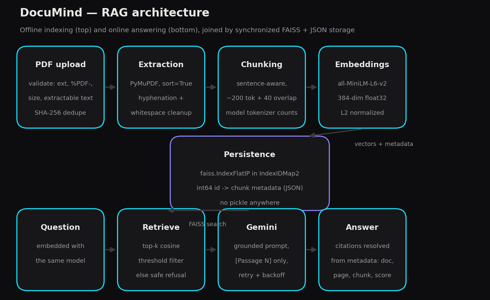

<!-- DOCUMIND README | dark-friendly | mobile-first -->

<div align="center">

<picture>
  <source media="(prefers-color-scheme: dark)" srcset="https://readme-typing-svg.demolab.com?font=Outfit&weight=800&size=34&pause=1200&color=19E6FF&center=true&vCenter=true&width=620&height=70&lines=DOCUMIND;Chat+with+your+PDFs.;Every+answer+has+receipts.">
  
</picture>

<br/>

<p align="center">
  <b>AI document intelligence with verifiable citations</b><br/>
  <i>First-principles RAG: no LangChain, no wrappers, every citation resolved from stored metadata</i>
  <br/><b>PyMuPDF</b> · <b>sentence-transformers</b> · <b>FAISS</b> · <b>FastAPI</b> · <b>Gemini</b>
</p>

<br/>

[](https://documind-bhkl.onrender.com/)
[](https://python.org)
[](https://fastapi.tiangolo.com)
[](https://render.com)

<br/>

<p>
  <a href="#-overview">Overview</a> &nbsp;•&nbsp;
  <a href="#-architecture">Architecture</a> &nbsp;•&nbsp;
  <a href="#-key-features">Features</a> &nbsp;•&nbsp;
  <a href="#-design-decisions">Decisions</a> &nbsp;•&nbsp;
  <a href="#-project-structure">Structure</a> &nbsp;•&nbsp;
  <a href="#-api">API</a> &nbsp;•&nbsp;
  <a href="#-getting-started">Get Started</a> &nbsp;•&nbsp;
  <a href="#-quality-and-known-limits">Limits</a>
</p>

</div>

---

##  Overview

**Live:** https://documind-bhkl.onrender.com/ (free hosting, first visit after idle can take about a minute to wake up)

> **DocuMind** lets you upload PDFs and ask questions in plain language. It indexes documents offline, retrieves the exact passages that matter with FAISS, and lets Gemini answer strictly from those passages, with citations that resolve to the real document name and page number.

| The problem | What DocuMind does |
|:---|:---|
| LLMs invent sources | The model only sees `[Passage N]` labels; titles and pages come from the metadata store, so citations cannot hallucinate |
| RAG demos hide the machinery | Every stage is plain, inspectable Python. No orchestration framework anywhere |
| Irrelevant questions get confident nonsense | Below a similarity threshold the system refuses instead of guessing |
| Pickle files are a code-execution risk | All persisted metadata is JSON. Untrusted bytes can never run code |

---

##  Architecture

Two deterministic pipelines connected by synchronized FAISS + JSON storage:

<div align="center">
  
</div>

**Indexing:** validate (extension, `%PDF-` magic bytes, size, extractable text) → SHA-256 dedupe → PyMuPDF page extraction with reading-order sorting → sentence-aware chunking (~200 tokens, 40 overlap) → all-MiniLM-L6-v2 embeddings, L2-normalized → `faiss.IndexFlatIP` inside `IndexIDMap2`, metadata as JSON.

**Answering:** the question is embedded with the same model → top-k exact cosine search with a relevance threshold → passages are numbered and sent to Gemini with a strict grounding prompt → `[Passage N]` references are validated against the retrieved set and resolved to document, page, chunk, score and raw text.

---

##  Key Features

| Feature | What you get |
|:---|:---|
| **Citation boundary** | The LLM never sees document names or page numbers. The UI renders only validated metadata records; out-of-range tags are dropped |
| **Sentence-aware chunking** | Chunks never sever a sentence mid-thought, with an abbreviation guard so "Fig. 3", "e.g." and "3.14" do not split early |
| **Defensive ingestion** | Magic-byte, corruption and text-extraction checks before any processing; SHA-256 content hash blocks duplicate indexing |
| **Multi-document** | Upload, list and delete many PDFs; per-document deletion uses int64 vector ids, not fragile string lookups |
| **Injection-resistant prompting** | Retrieved text is wrapped in context delimiters and treated as data, so a hostile PDF cannot steer the model |
| **Polished SaaS UI** | Responsive landing page plus upload and chat workspace, citation cards with scores and expandable source text |

---

##  Design Decisions

Deliberate deviations from the original blueprint, each with a reason:

| Decision | Why |
|:---|:---|
| ~200-token chunks, 40 overlap (not 500/100) | all-MiniLM-L6-v2 truncates input at 256 word-pieces; a 500-token chunk loses its second half in the embedding |
| Tokens counted with the model's own tokenizer | Chunk sizing must match what the model actually sees; a foreign tokenizer miscounts |
| `IndexIDMap2` with an int64 → metadata JSON map | FAISS deletion needs integer ids, while `doc_id` is a SHA-256 string |
| FastAPI + web frontend (not Streamlit) | Deploys as one standard web service with a production UI |
| `gemini-3.5-flash-lite` default, model in `.env` | Verified GA endpoint; swap to `gemini-4-hydrogen` without a code change |
| 0.25 similarity threshold is a starting point | Tune on in-scope plus out-of-scope questions and measure recall@k before trusting it |
| Sample PDFs fetched by script, not committed | Keeps binaries out of git history; `python scripts/download_samples.py` restores them |

---

##  Project Structure

```
DocuMind-AI-Document-Intelligence/
├── server.py                FastAPI entrypoint: REST API + static frontend
├── src/
│   ├── config.py            Central settings, env validation, paths
│   ├── pdf_processor.py     Validation, PyMuPDF extraction, OCR hook
│   ├── text_chunker.py      Sentence splitting, token-window packing
│   ├── embeddings.py        SentenceTransformer wrapper, L2 normalization
│   ├── vector_store.py      FAISS IndexIDMap2 + JSON persistence
│   ├── retriever.py         Query embedding, top-k, threshold filter
│   ├── llm.py               Gemini client, grounded prompt, retries
│   ├── rag_pipeline.py      Retrieval + prompt + citation resolution
│   ├── document_manager.py  Registry, SHA-256 dedupe, deletion
│   └── utils.py             Logging, hashing, formatting
├── static/                  SaaS frontend (HTML, CSS, JS, logo)
├── scripts/download_samples.py  Fetch the evaluation PDFs
├── data/sample_pdfs/        Evaluation documents (gitignored)
├── storage/                 FAISS indexes + JSON metadata (gitignored)
├── tests/                   60 tests across all pipeline stages
├── assets/                  Logo and architecture diagram
├── render.yaml              One-click Render blueprint
└── requirements.txt         Pinned dependency manifest
```

---

##  API

| Method | Endpoint | Purpose |
|:---|:---|:---|
| `GET` | `/api/health` | Model, index size, key status |
| `GET` | `/api/documents` | List indexed documents |
| `POST` | `/api/documents` | Upload and index a PDF (multipart) |
| `DELETE` | `/api/documents/{doc_id}` | Remove a document and its vectors |
| `POST` | `/api/chat` | `{question, doc_id?}` → grounded answer + citations |

---

##  Getting Started

```bash
python -m venv venv && source venv/bin/activate
pip install --extra-index-url https://download.pytorch.org/whl/cpu -r requirements.txt
cp .env.example .env          # add your GEMINI_API_KEY
python scripts/download_samples.py
uvicorn server:app --reload   # http://localhost:8000
pytest                        # 60 tests, no API key needed
```

Get a Gemini key at [aistudio.google.com/apikey](https://aistudio.google.com/apikey). Without it the app still indexes and searches; only answer generation is disabled.

### Deploy on Render (free)

1. Push this repo to GitHub.
2. Render dashboard → New → Blueprint → pick the repo (it reads `render.yaml`).
3. Set `GEMINI_API_KEY` when prompted. Deploy.

The free plan sleeps after 15 minutes idle; the first visit after idle takes about a minute while the embedding model loads.

### Evaluation datasets

| Tier | Document | What it validates |
|:---|:---|:---|
| Baseline | NIST Cybersecurity Framework 2.0 | Structured taxonomy, exact page citations |
| Scale | NASA Systems Engineering Handbook | Multi-hundred-page latency and memory, top-k tuning |
| Edge cases | Any 3–5 page report | Dense bullets, tables, out-of-scope refusals |

---

##  Quality and Known Limits

- **OCR is an optional hook.** Scanned pages are detected and flagged; actual OCR needs `pytesseract`, `Pillow` and a system `tesseract` binary, which are not installed by default.
- **Threshold is a heuristic.** 0.25 works reasonably for MiniLM cosine scores, but tune it on your own documents and measure recall@k.
- **Free-tier memory.** torch + the embedding model run close to the 512 MB Render free limit. One worker and `OMP_NUM_THREADS=1` are set; upgrade the plan if you see out-of-memory restarts.
- **Index is local.** Storage lives on the service disk, so redeploys on the free plan reset the index. Re-upload documents after a deploy.
- **Single user.** No accounts or auth; anyone with the URL can upload and ask.

---

<div align="center">

© 2026 All rights reserved.<br/>
Designed & Developed by **Vivek Sah**

</div>
