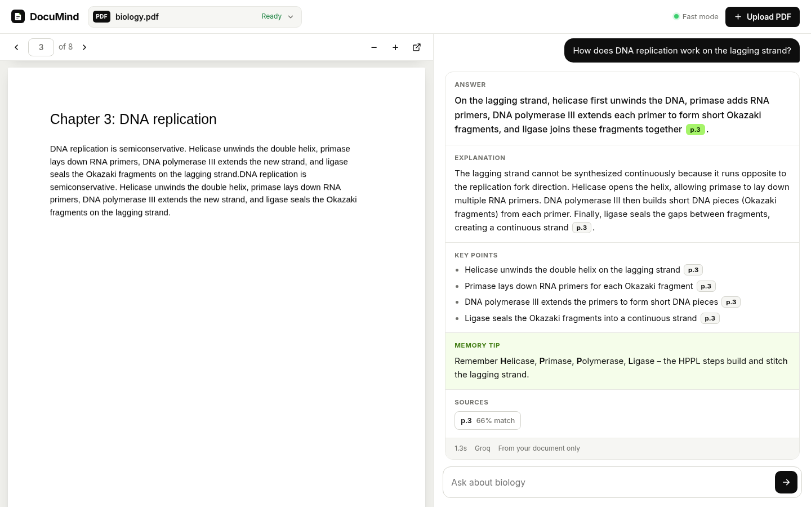
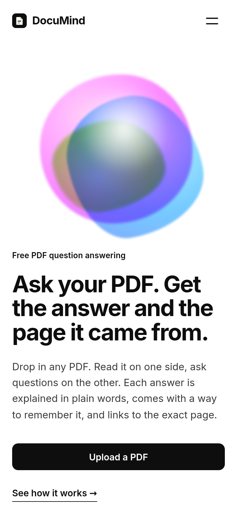
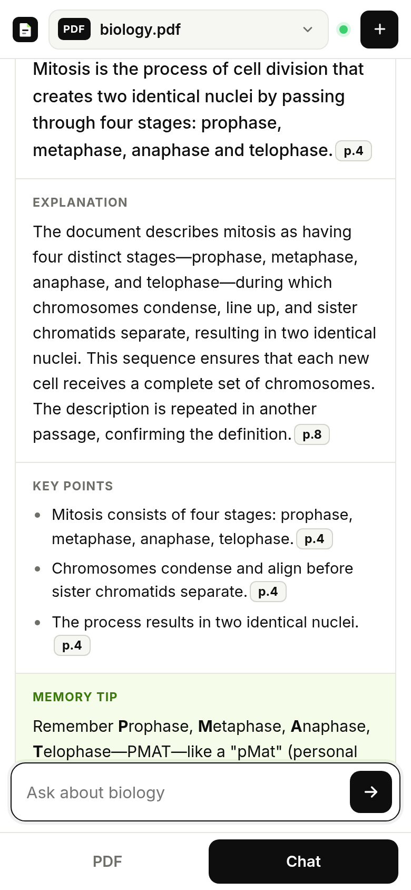

# DocuMind

Upload any PDF, read it in the browser and ask questions about it. Every answer is grounded in the document and comes with an explanation, key points, a memory tip and links that open the PDF at the exact page.

**Live demo:** https://documind-bhkl.onrender.com/ (free hosting, the first visit after idle can take about a minute to wake up)


<p align="center">
  
</p>

## How it works

1. **Upload.** The PDF opens in the viewer immediately, straight from the browser. Nothing is preloaded: the app starts empty.
2. **Index.** In the background the server validates the file, extracts text page by page (scanned pages go through OCR), splits it into short passages, embeds them with all-MiniLM-L6-v2 and stores them in FAISS. The chat unlocks when this finishes.
3. **Ask.** The question is embedded and matched against the passages by exact cosine similarity. A fast LLM answers from those passages only. If nothing relevant is found, the app says the document does not contain the answer.
4. **Verify.** Citation pills and source buttons jump the viewer to the page the text came from.

<p align="center">
  
</p>

## Features

| Area | Details |
|:---|:---|
| Upload first | Empty start screen, drag and drop, instant preview while the file is indexed in the background |. File names with dashes, accents or non-Latin text preview correctly after a refresh
| Any PDF | Text PDFs, scans (OCR through Gemini vision, first 40 pages), no required `.pdf` extension, duplicates detected by SHA-256, clear errors for corrupt or password-protected files |
| Study-friendly answers | Answer, explanation, key points, memory tip and sources in a fixed layout |
| Tutor chat (default) | A conversation, not a form. It leads with the exact answer, then teaches from the basics in plain words, remembers earlier turns so "explain it simpler" or "what about the second one?" work, cites page links, and says so when the PDF does not cover something. Each reply suggests follow-up questions. Outside analogies are labelled as not from the document |
| Readable formulas | Formulas are typeset as proper math (KaTeX, loaded from a free CDN) with a plain-notation fallback, never raw LaTeX. Citation lists such as "Passage 1-2, 11" are expanded into page pills |
| Saved chats | Each PDF keeps its own chat in your browser (localStorage), so it survives a reload and switching between PDFs. Nothing is stored on the server, and removing a PDF deletes its saved chat |
| Deep dive | Ask for a topic and get a full briefing: overview, step by step sections, key takeaways, memory tip and what the PDF does not cover. Retrieval is wider, pulls in the neighbouring passages and reads them in page order. Turn on the Deep dive toggle for a structured briefing on a topic |
| Audio briefing | "Listen" reads any answer aloud next to the written chat answer, with stop and speed controls. "Voice" auto-reads every new answer. Uses the browser's built-in speech synthesis: free, no key, nothing sent to a server |
| Accurate citations | Chunks never cross a page boundary. The model only sees `[Passage N]` labels, and page numbers come from stored metadata, never from the model |
| Free models, automatic fallback | Groq `openai/gpt-oss-120b` first (about 1 to 2 s), then Gemini `gemini-3.5-flash`, then Groq `gpt-oss-20b`. Groq's free tier allows 8,000 tokens a minute, so busy minutes fall through to the next model |
| Safe by design | Retrieved text is treated as data (prompt-injection resistant), JSON-only persistence (no pickle), rate limits, API keys read from environment variables only and redacted from logs |
| Responsive | Side-by-side layout on desktop, PDF and Chat tabs on phones and tablets, no horizontal overflow |
| Multi-document | Switch between uploaded PDFs, search one or all, remove any file |

## Screenshots

<p align="center">
  
  <br><sub>Landing page</sub>
</p>

<p align="center">
  
  &nbsp;&nbsp;
  
  <br><sub>Mobile: landing page and chat tab</sub>
</p>

## Tech stack

| Layer | Choice |
|:---|:---|
| Backend | FastAPI, Uvicorn |
| PDF | PyMuPDF (text extraction, page rendering for OCR) |
| Embeddings | all-MiniLM-L6-v2 on ONNX Runtime via fastembed (no PyTorch) |
| Vector search | FAISS `IndexFlatIP` inside `IndexIDMap2` |
| LLM | Groq (primary), Google Gemini (fallback and OCR) |
| Frontend | Plain HTML, CSS and JavaScript, pdf.js for the viewer, Inter font |

Everything above runs on free tiers.

## Getting started

```bash
git clone https://github.com/vivek-sah23/DocuMind-AI-Document-Intelligence.git
cd DocuMind-AI-Document-Intelligence
python -m venv venv && source venv/bin/activate
pip install -r requirements.txt
cp .env.example .env        # add GROQ_API_KEY and/or GEMINI_API_KEY
uvicorn server:app --reload # http://localhost:8000
```

Free keys: [console.groq.com/keys](https://console.groq.com/keys) and [aistudio.google.com/apikey](https://aistudio.google.com/apikey). Without a key the app still uploads, previews and indexes; only answers are disabled.

## Configuration

All settings are environment variables, read once in `src/config.py`.

| Variable | Default | Purpose |
|:---|:---|:---|
| `GROQ_API_KEY` | none | Fast answers |
| `GROQ_MODEL` | `openai/gpt-oss-120b` | Groq model |
| `GEMINI_API_KEY` | none | Fallback answers and OCR for scanned pages |
| `GEMINI_MODEL` | `gemini-3.5-flash-lite` | Gemini model |
| `CHUNK_SIZE_TOKENS` / `CHUNK_OVERLAP_TOKENS` | `200` / `40` | Passage size |
| `TOP_K` | `5` | Passages per question |
| `MIN_SIMILARITY_SCORE` | `0.25` | Below this the app refuses instead of guessing |
| `DEEP_TOP_K` / `DEEP_MAX_CHUNKS` | `10` / `18` | Best matches and total passages in deep dive |
| `DEEP_MIN_SCORE` | `0.2` | Relevance floor for deep dive |
| `GEMINI_TUTOR_MODEL` | `gemini-3.5-flash` | Gemini model for the tutor chat |
| `MAX_FILE_SIZE_MB` | `50` | Upload limit |

## API

| Method | Endpoint | Purpose |
|:---|:---|:---|
| `GET` | `/` and `/app` | Landing page and the app |
| `GET` | `/api/health` | Models, key status, index size |
| `GET` | `/api/documents` | List indexed documents |
| `POST` | `/api/documents` | Upload a PDF. Returns `202` with `status: indexing`, or `200` with `duplicate: true` |
| `GET` | `/api/documents/{id}/status` | `indexing`, `ready` (with the document record) or `failed` (with a reason) |
| `GET` | `/api/documents/{id}/file` | The original PDF, for the viewer |
| `DELETE` | `/api/documents/{id}` | Remove a document, its vectors and its stored file |
| `POST` | `/api/chat` | `{question, doc_id?, mode?, history?}`. `mode` is `tutor` (default), `deep` or `quick`. Tutor takes `history` (up to 12 recent `{role, text}` turns) and returns `answer` (Markdown), `follow_ups`, `citations`, `pages`, `refused` and `chat`. Quick returns answer, explanation, key points, memory tip and citations. Deep returns title, overview, sections, key points, memory tip, gaps, pages and citations |

## Project structure

```
server.py              FastAPI app, background indexing, REST API
src/
  config.py            Settings and paths
  pdf_processor.py     Validation, page-aware extraction, OCR hook
  ocr.py               Gemini vision OCR for scanned pages
  text_chunker.py      Sentence-aware, page-bounded chunking
  embeddings.py        MiniLM (ONNX) wrapper
  vector_store.py      FAISS index and JSON metadata
  retriever.py         Top-k search with a relevance threshold
  llm.py               Groq and Gemini clients, grounded prompt, fallback
  rag_pipeline.py      Retrieval, generation, citation validation
  document_manager.py  Registry, SHA-256 dedupe, deletion, stored PDFs
static/                Landing page, app, styles, scripts
tests/                 95 tests
render.yaml            Render blueprint
```

## Testing

```bash
pytest
```

The suite runs offline with no API keys. API tests use throwaway storage, so they never touch real uploads. Covered: validation (including password-protected and corrupt files), extraction and the OCR fallback and its page budget, chunking (no chunk spans two pages), FAISS add and delete, retrieval thresholds, deep-dive retrieval and parsing, citation validation, rate limiting, secret redaction, and the upload, status, preview, chat and delete flow.

## Deployment

Render free plan, configured by `render.yaml`:

1. Create a new Blueprint from this repository.
2. Set `GROQ_API_KEY` and `GEMINI_API_KEY` as secret environment variables.
3. Deploy. Pushes to `main` redeploy automatically.

## Design decisions

| Decision | Reason |
|:---|:---|
| 200-token chunks with 40 overlap | MiniLM truncates at 256 word-pieces, so larger chunks lose their second half in the embedding |
| One page per chunk | A chunk has one page number. Spanning pages would make citations open the wrong page |
| `IndexIDMap2` with int64 ids | FAISS deletes by integer id, while document ids are SHA-256 strings |
| Background indexing | Large PDFs take a while on a free CPU. The viewer opens at once and the UI polls for status |
| Original PDFs stored beside the index | Powers the viewer and is removed with the document |
| JSON metadata, never pickle | Untrusted input can never execute code on load |
| ONNX embeddings | Fits the 512 MB free Render limit |

## Limitations

- **Shared demo.** The hosted demo has no accounts, so uploads are visible to every visitor. Use public or sample PDFs only.
- **Ephemeral storage.** On the free plan, uploads and the index reset when the service restarts or redeploys.
- **OCR budget.** Scanned PDFs are read up to the first 40 pages to stay inside the free Gemini quota.
- **Free-tier resilience.** Answers try five free models in order (Groq gpt-oss-120b, Gemini 3.5 Flash, Groq gpt-oss-20b, Groq Qwen 3.8 27B, Gemini Flash-Lite), skipping any that is rate-limited or times out. If all are busy, the chat shows the most relevant PDF passages with page links instead of an error, and the browser retries cold starts and dropped connections automatically.
- **Tutor quality.** The free models are strong but not frontier-level. Answers are grounded in the retrieved passages only, so a very broad question can miss a detail that sits on a page the search did not pick up. Ask again with a narrower topic. The tutor sends only the last few turns to the model. Saved chats live in this browser only (up to 40 exchanges per PDF), so they do not follow you to another device or browser, and clearing site data erases them.
- **Audio.** Listen and Voice depend on the browser's speech voices, so the voice differs per device. Deep dive answers are limited to what the retrieved passages say, so a very broad topic may need a follow-up question.
- **Cold start.** The free service sleeps when idle and takes about a minute to wake.
- **Threshold.** 0.25 is a reasonable starting point for MiniLM cosine scores. Tune it on your own documents.

---

Designed & Developed by **Vivek** · © 2026 All rights reserved.
